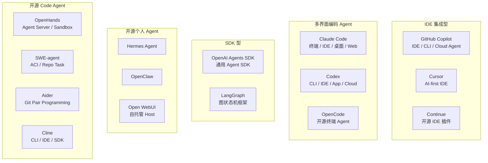

# 第 19 章：主流框架与开源项目架构分析

> **难度等级：** ⭐⭐⭐⭐⭐
> **所属模块：** 第六部分：案例、选型与索引
> **来源可信度：** 官方文档 / 源码 / 推导 / 观点
> **状态：** ✅ 已完成
> **事实核查日期：** 2026-10-26
> **核查范围：** 本轮阅读官方文档与公开仓库说明，并记录开源项目的提交快照。没有安装运行竞品、复现安全边界或测量性能；文档能力记为 Official Fact，运行效果和未查证字段记为 Unknown，不把开源声明等同于验证通过。

---

## 学习目标

完成本章学习后，你将能够：

1. 理解代表性 Agent 产品、SDK 与开源项目的架构设计
2. 对比各框架在 Runtime、Tool Registry、Memory、MCP、A2A、Hooks、Skills 等维度的设计差异
3. 掌握框架选型的评估标准
4. 理解各框架的设计哲学和适用场景
5. 从框架设计中提取可复用的架构模式

---

## 前置知识

- 建议阅读第 1--14 章，先建立组件和互操作的判断框架
- 阅读第 17--18 章后，可将工程约束和评估契约用于真实试点比较
- 了解各框架的基本使用方式

---

## 1. 分析框架

> **图 19-1：** 代表性产品与框架的主要定位。产品可能跨越多个界面，分类用于选型分析而非互斥标签；具体能力随版本变化，应以本章核查日期和官方资料为准。

---

## 2. 分析维度

本章用以下 14 个维度指导选型。第 3～8 节只写已核查的产品边界；第 8.7 节集中比较开源项目的 6 个治理维度，不把缺少证据的格子填成“不支持”。未覆盖的维度为 `Unknown（未核查）`。支持某能力不等于已验证其生产效果；闭源产品的内部 Runtime、Planner 与上下文选择算法不作事实断言。

| 维度 | 说明 |
|------|------|
| Runtime | Agent 主循环的设计与实现 |
| Planner | 任务规划和分解机制 |
| Tool Registry | Tool 的注册、发现和调度 |
| Memory | 记忆管理与上下文策略 |
| MCP Client | MCP 协议的集成方式 |
| Hooks | 生命周期事件拦截 |
| Skills | 可复用工作流支持 |
| Context 管理 | 上下文窗口管理策略 |
| Agent / Host 形态 | SDK、Personal Assistant、Code Agent 或 Agent Server 的边界 |
| 状态与恢复 | Session、Task、Run、Checkpoint、Artifact 和长任务恢复 |
| Sandbox / Workspace | 文件、命令、网络、工作区和进程的实际执行边界 |
| Approval / Policy | `allow / ask / deny`、人工介入、撤销和审计 |
| Agent Interoperability | MCP、A2A、ACP 的支持范围和协议边界 |
| Evaluation / Trace | 轨迹、评估、成本、质量和安全指标的可观测性 |

> **来源类型：** 推导分析 —— 基于各框架官方文档和源码的架构分析。标注为「推导」的内容基于公开信息推断，可能与实际实现有差异。

### 2.1 产品事实维护矩阵

本章的产品事实不是永久结论。每次版本更新至少记录核查日期、官方页面或源码入口，并将结论分为四类：

| 标记 | 可写入正文的内容 | 维护要求 |
|------|------------------|----------|
| Official Fact | 官方文档、官方公告或官方源码直接确认的能力 | 保留链接、版本/页面日期；能力消失时立即修订 |
| Public Behavior | 可重复的公开产品行为、CLI 输出或公开 API 响应，但不等于内部机制 | 记录复现条件和 Surface；不得外推为内部实现 |
| Inference | 由公开行为、界面或源码结构推导的架构解释 | 明确写“推导”，不得写成官方事实 |
| Unknown | 官方未公开、版本差异过大或无法复现的内容 | 写明未知，不用相邻产品经验填空 |

建议审查顺序：先检查产品定位和官方能力链接，再复现必要的 Public Behavior，随后检查对比表中的证据标签，最后运行本书示例和评估契约。产品名、模型名、价格、套餐、支持的 Transport、默认权限和工具列表都属于高变化字段，不应只依赖本章旧文字。

---

## 3. GitHub Copilot

**核查对象：** GitHub.com Surface。官方描述了仓库问答、委派编码、PR 审查与自动化；多步任务可以在云开发环境中读写文件和执行测试。不能把这些行为反推为所有 IDE 插件都使用同一个内部 Planner。

**架构启示（推导）：** 把 Issue / PR / 自动化触发等产品入口与具体执行环境分开，产物回到仓库工作流。为试点记录仓库权限、触发身份和执行环境，不能仅写“Copilot 支持 Agent”。数据保留、恢复语义和跨 Surface 权限等价性为 Unknown，需专项验证。

来源：[Copilot on GitHub.com](https://docs.github.com/en/copilot/concepts/copilot-surfaces/copilot-on-github)。

## 4. Claude Code

**核查对象：** 官方多平台产品概览。终端、IDE、桌面、云端和远程控制是不同使用入口；官方文档分别讨论 Session、Instructions / Memory、扩展与权限。具体部署的可用功能仍受版本和配置约束。

**架构启示（推导）：** 多界面不应各自拥有一套执行事实；Host 应统一 Session、运行状态、审批请求与事件投影。CLI 的权限设置不能直接外推到云端隔离环境；模型内部规划和服务端实现为 Unknown。

来源：[Claude Code Overview](https://code.claude.com/docs/en/overview)。

## 5. Cursor

**核查对象：** Agent 与 Agent Skills 官方文档。当前 Cursor 已有独立的 Skills，支持目录发现、按需加载和手动调用；不能再以“只有 Rules、没有 Skills”描述它。Rules 与 Skills 仍是不同用途的扩展面。

**架构启示（推导）：** 文件格式兼容不意味着部署范围相同。官方 Skills 文档明确区分本地用户目录与云端 / 远程 Worker，不能假定用户本地 Skill 自动随任务上传。上下文目录、安装来源、同步和执行授权应分别建模。

来源：[Agent Overview](https://cursor.com/docs/agent/overview)、[Agent Skills](https://cursor.com/docs/skills)。

## 6. OpenAI Agents SDK 与托管 Runtime

**核查对象：** Agents SDK 与官方 Runtime 分层说明。Agents SDK 在应用中运行，由应用选择存储、审批和运行环境；Agents API 提供托管 Codex harness；Responses API 提供模型与工具调用接口。三者承担的运行责任不同，不能把 SDK 等同于托管长任务服务。

SDK 文档列出了 Agent / Runner、Tools、Handoffs、Guardrails、Sessions 与 Tracing。Session 保存对话不等于任意外部写操作都能安全恢复；Checkpoint、幂等与副作用核对仍需按具体适配器验证。跨 Provider 的 Tool、结构化输出、用量和取消等价性为 Unknown，需同任务测试。

**架构启示（推导）：** 选型先问“谁负责运行、存储和隔离”，再比较 API 便利性。新版本还提供 Sandbox Agents 等集成，故“SDK 永远不提供沙箱集成”也不是可靠结论；隔离强度取决于实际后端。

来源：[SDK 官方文档](https://openai.github.io/openai-agents-python/)、[Runtime 责任比较](https://developers.openai.com/api/docs/guides/agents#compare-agent-runtime-options)。

## 7. LangGraph 与 Deep Agents

**核查对象：** LangGraph Persistence 与 Deep Agents Overview。LangGraph 用 Checkpointer 保存线程内图状态，用 Store 保存跨线程数据；前者支持中断、恢复与历史状态，后者承载长期信息。两者不能只用一个“Memory”标签概括。

Deep Agents 在这一生态中提供组合好的 harness，包含文件系统上下文管理、子代理委派与记忆，并可按需扩展规划和 Skills。它与自定义状态图处在不同抽象层，不能简单列为两个互斥竞争框架。

**架构启示（推导）：** 需要自定义控制图时比较 LangGraph；需要现成循环与上下文能力时比较 Deep Agents。后者的虚拟文件系统和 Middleware 不是 OS 隔离的同义词。官方文档还指出，文件系统 Tool Allowlist 不约束自定义 Tool，声明式子代理需要独立配置相应限制；因此必须审查每条执行路径。

来源：[LangGraph Persistence](https://docs.langchain.com/oss/python/langgraph/persistence)、[Deep Agents Overview](https://docs.langchain.com/oss/python/deepagents/overview)、[开源仓库](https://github.com/langchain-ai/deepagents)。

## 8. Continue

**核查对象：** 官方首页与配置导航。Continue 提供 VS Code / JetBrains 扩展及 CLI，包含 Agent、Chat、Edit 与 Autocomplete。当前导航使用 Models、MCP Servers、Rules、Prompts 和 `config.yaml`，并将旧 Context Providers 等入口标为 Deprecated。

**架构启示（推导）：** 编辑器上下文、模型角色和工具配置应有明确兼容边界。旧教程中的 `@Codebase` 或 Context Provider 配置不能直接当成当前推荐接入方式；内部 Planner、跨进程恢复和隔离强度为 Unknown，不能用社区规模或“Agent 较新”代替分析。

来源：[Continue Docs](https://docs.continue.dev/)。

### 8.5 开源 Harness 与个人助理：公开能力和取舍

下表中的能力是本轮文档核查结果；“启示”是本书推导。各项目没有在统一环境下进行性能、安全或成功率对比。

| 项目 | 已确认的公开设计 | 可以借鉴的取舍 | 直接来源 |
|------|------------------|----------------|----------|
| Codex | 开源 CLI、SDK 与 app-server；应用可通过协议管理 Thread、Turn、流式事件与审批 | 产品上下文和业务授权归应用，Agent 循环与运行协议可以复用；模型与托管服务不因 harness 开源而开源 | [平台分层说明](https://developers.openai.com/blog/codex-as-a-platform) |
| OpenCode | `allow / ask / deny` 权限，模式规则最后匹配者生效；工作区外路径有独立授权 | 策略顺序和路径范围必须可解释；不能把多个项目的规则列表直接拼接 | [Permissions](https://opencode.ai/docs/permissions/) |
| OpenHands | 主仓库管理 Agent Canvas 与本地编排，SDK 仓库拥有 Agent Server、Tools、Conversations、Workspaces 与 Events；Automation 决定何时派发 | UI、触发调度与执行事实分开拥有，减少重复 Runtime | [主仓库职责表](https://github.com/OpenHands/OpenHands)、[SDK](https://github.com/OpenHands/software-agent-sdk) |
| Hermes Agent | 按需加载的 Skills、持久记忆、MCP、Cron 与多消息平台入口 | 用户偏好与可执行工作流分开；自动产生的 Skill 仍需来源和权限审查 | [Skills](https://hermes-agent.nousresearch.com/docs/user-guide/features/skills)、[项目文档入口](https://github.com/NousResearch/hermes-agent) |
| OpenClaw | Gateway 统一 Session、Tools、Events 和 Channel；安全文档说明一个 Gateway 对应一个信任边界 | 消息接入不自动构成多租户隔离；不互信用户应拆分凭据与执行边界 | [项目说明](https://github.com/openclaw/openclaw)、[Security](https://docs.openclaw.ai/gateway/security) |
| Deep Agents | 组合文件系统上下文、委派与记忆，支持多种 Backend | 按能力选择 Middleware 和 Backend，分别验证主 Agent、自定义 Tool 与子代理 | [Overview](https://docs.langchain.com/oss/python/deepagents/overview) |

“开源”只说明可检查、修改和分发的范围，实际许可证需按采用的提交和子目录确认。开源不保证隔离、可靠恢复、模型可离线使用或托管服务免费。

### 8.6 移动端与 GUI Agent：把动作接口和评估环境分开

[AndroidWorld](https://github.com/google-research/android_world) 提供运行在 Android 模拟器上的任务环境、参数化任务和可检查的奖励信号。它是评估环境，不是可直接嵌入手机的生产 Agent Host。

对 Helix 这类设备 Agent，可以借鉴其前置状态构造和结果检查方法：固定应用版本与任务种子，执行后读取可核验的业务状态，而不是仅看 Agent 最后的“已完成”。模拟器权限和重置能力不能直接外推到普通手机；Accessibility、Shizuku、Root 等权限组合需要独立验收，详见[第 17 章](../17-engineering-practice/README.md)和[第 18 章](../18-best-practices/README.md)。这里给出的是工程方法，不声称这些项目已在本书中完成设备接入。

### 8.7 六个治理维度的证据矩阵

`文档` 表示公开资料有对应设计，未做运行验证；`Unknown` 表示本轮没有足够证据。每格仅覆盖写出的范围，不是完整功能勾选表。

| 项目 | Agent / Host 形态 | 状态与恢复 | Sandbox / Workspace | Approval / Policy | 互操作 | Evaluation / Trace |
|------|------------------|------------|---------------------|-------------------|--------|--------------------|
| Codex | 文档：CLI / SDK / app-server | 文档：Thread / Turn；外部副作用恢复 Unknown | 文档：配置的 Sandbox；效果未测 | 文档：审批请求；业务授权仍归应用 | 文档：应用提供 MCP；协议版本需核查 | 文档：事件流；评估效果 Unknown |
| OpenCode | 文档：开源 Coding Agent | Unknown：本轮未核查恢复存储 | 文档：外部目录权限；OS 隔离 Unknown | 文档：三态与最后匹配规则 | Unknown：本轮未逐版本核查 | Unknown |
| OpenHands | 文档：Canvas / SDK / Server / Automation 分层 | 文档：Conversation / Event；崩溃一致性 Unknown | 文档：Workspace；后端隔离未测 | Unknown：本轮未核查持久审批 | Unknown：本轮未做兼容测试 | 文档：Events；评估效果 Unknown |
| Hermes Agent | 文档：个人助理、多通道与 Cron | 文档：持久记忆；运行恢复 Unknown | 文档：容器隔离入口；未测 | 文档：命令审批；持久性 Unknown | 文档：MCP 接入；版本 Unknown | Unknown |
| OpenClaw | 文档：Gateway 与多 Channel | 文档：Session；副作用恢复 Unknown | 文档：主 Session 默认 Host 执行，可配置 Sandbox | 文档：配对与信任边界；非敌对多租户边界 | Unknown：本轮未做版本兼容验证 | 文档：Events；质量评估 Unknown |
| Deep Agents | 文档：基于 LangGraph 的 harness | 文档：生态持久化；具体配置需验证 | 文档：Backend；虚拟文件系统不等于 OS Sandbox | 文档：文件系统 Tool 限制；自定义 Tool 另审 | Unknown：本轮未做协议兼容测试 | Unknown：未跑统一评估 |

官方页面可以随时变化。复现本轮研究时使用以下默认分支快照；**这些 SHA 是读取仓库元数据时的定位记录，不表示本书逐行审计了该提交，更不表示稳定 Release 或生产推荐版本。**

| 仓库 | 分支 | 2026-10-26 核查快照 |
|------|------|--------------------|
| openai/codex | main | [970111f6cb62](https://github.com/openai/codex/commit/970111f6cb62cc02fe36a82ea7d71b37a2889c97) |
| anomalyco/opencode | dev | [d8607b6616a5](https://github.com/anomalyco/opencode/commit/d8607b6616a50d6b89dba2ed46fec99c9457cc97) |
| NousResearch/hermes-agent | main | [25db5877c1c7](https://github.com/NousResearch/hermes-agent/commit/25db5877c1c78ff13878fa86bab21ba6c9636231) |
| openclaw/openclaw | main | [eff88aecc7a4](https://github.com/openclaw/openclaw/commit/eff88aecc7a484080747e1e7c89e0e9d1232e83e) |
| OpenHands/software-agent-sdk | main | [e324989c4153](https://github.com/OpenHands/software-agent-sdk/commit/e324989c415334eb3fcefcb5dffafa194a409471) |
| langchain-ai/deepagents | main | [bcad8dffff4d](https://github.com/langchain-ai/deepagents/commit/bcad8dffff4d27676c87d9587cf49c038a89bf98) |
| google-research/android_world | main | [55ddaf5edc6f](https://github.com/google-research/android_world/commit/55ddaf5edc6f6c25673aed343907d5b9dca66f84) |

---

## 9. 框架与项目对比

“易用性”和“架构完整度”无法在不同产品、团队和版本之间得到可复核的统一分数，因此本书不再使用带精确坐标的能力象限。选型应从实际控制边界开始：

| 首要约束 | 应优先比较的候选类型 | 需要验证的 Trade-off |
|----------|----------------------|----------------------|
| IDE 内的低摩擦编码体验 | IDE 集成型产品 | 工作区权限、企业策略、离线/私有部署和可扩展性 |
| 终端与仓库工作流 | CLI 型 Agent | Shell 与文件权限、审批、非交互执行和审计 |
| 自建单 Agent 或服务 | SDK 型框架 | Tool 模型、trace、评估、模型提供商和部署控制 |
| 显式状态图、长任务恢复 | 工作流 / 图框架 | 状态模型学习成本、持久化、幂等和运维 |
| 开源扩展或多模型接入 | 可自托管的插件 / SDK 方案 | 维护责任、生态成熟度和安全更新 |

> **来源类型：** 推导分析。该表是选型起点，不是产品排名；应使用同一任务、同一数据边界和同一评估契约进行试点比较。

### 9.1 试点核查表

静态“✅ / ❌”矩阵很容易把产品版本、部署选项和相邻能力混成一个结论。对每个候选方案，应在相同任务与数据边界下记录下表，而不是把本书的抽象层直接当成产品功能名。

| 维度 | 应核查的证据 | 不应由此推断 |
|------|--------------|--------------|
| Tool 与 MCP | 当前版本的连接方式、本地/远程传输、授权和 Tool 暴露范围 | “支持 MCP”就自动满足权限、审计或企业部署要求 |
| 状态与恢复 | 会话、检查点、存储后端、恢复与幂等语义 | 有对话历史就等于可恢复长任务 |
| Hooks 与人工介入 | 事件点、拒绝/审批状态、取消与审计 API | 有回调或 UI 就等于具备可治理的审批模型 |
| Skills / 指令 | 发现、加载、版本、上下文预算和用户可见性 | Rules、Slash Command 或 Prompt 文件天然等同于 Skill Registry |
| 模型与部署 | 可用 Provider、区域、私有化、数据保留与降级策略 | 一个产品标签可以代表所有部署模式的能力 |

> **试点记录建议：** 为每个候选记录产品版本、部署方式、官方链接、测试日期、通过的评估契约和未满足的约束。这样能力变化时只需重跑试点，而不是维护一张容易过期的勾叉表。

### 9.2 选型指南

| 场景 | 候选方向 | 需要进一步验证 |
|------|---------|------|
| 日常编码辅助 | GitHub Copilot、Cursor、Continue 等 IDE 集成型产品 | 支持的 IDE、组织策略、模型、MCP 与本地数据边界 |
| 终端开发工作流 | Claude Code 或同类 CLI Agent | Shell/文件授权、自动化能力、审计与团队工作流 |
| 构建自定义 Agent | OpenAI Agents SDK、LangGraph 或其他 SDK | 控制流、状态、模型提供商、trace、评估与部署需求 |
| 复杂工作流编排 | LangGraph 或同类状态机/工作流框架 | 恢复语义、持久化后端、图模型复杂度和运行成本 |
| 开源定制 | Continue、开源 SDK 或自建组件 | 维护投入、升级节奏、模型兼容性与安全响应 |
| 学习 Agent 架构 | MVP + 任选一个 SDK/产品的公开文档 | 以第 2、14、16、18、19 章的概念和评估契约检查观察结果 |

---

## 10. 架构模式提取

### 10.1 从框架中提取的通用模式

| 本书抽象 | 可从公开资料观察到的实现方式 | 边界 |
|----------|----------------------------------|------|
| Agent Loop | SDK 可能公开执行循环；产品通常只暴露多步行为 | 不假定所有产品公开其规划或终止算法 |
| Tool 管理 | 代码 API、Host 配置或 ToolNode 等方式管理能力 | 不假定存在名为 Tool Registry 的统一内部模块 |
| MCP 集成 | 支持 MCP 的 Host 可协商并连接外部能力 | 具体版本、传输、授权和审批仍需逐项核查 |
| Skills / 指令 | Host 可提供 Skill、Rule、Prompt 文件或子图等复用机制 | 名称相近不表示生命周期、发现或权限语义相同 |
| Hooks / 人工介入 | 事件 API、节点拦截或审批状态可承载横切控制 | 回调不自动构成安全边界，审批不自动持久化 |
| 状态持久化与 Handoff | 部分框架提供检查点、状态图或控制权转移抽象 | 应验证恢复、幂等、跨系统身份与审计语义 |

---

## 11. 最佳实践

1. **不要过早选定框架：** 先理解 Agent 架构原理，再根据需求选择框架。
2. **评估互操作边界：** 若需要连接外部能力，比较 MCP、直接 API 与 Host 插件模型的授权、部署和运维代价。
3. **评估可定制性：** 如果未来需要深度定制，优先选择开源框架。
4. **用代表任务决定抽象层：** 对比自建 Loop、SDK、完整 Harness 和状态图的接入成本；使用相同权限、模型与验收任务测量，不按品牌推断学习成本或效果。

---

## 12. 官方参考

| 编号 | 来源 | 类型 | 说明 |
|------|------|------|------|
| REF-1 | [GitHub Copilot Docs](https://docs.github.com/en/copilot) | 官方文档 | Copilot 完整文档 |
| REF-2 | [Claude Code Docs](https://code.claude.com/docs) | 官方文档 | Claude Code 的终端、IDE、桌面与 Web 形态 |
| REF-3 | [Cursor Docs](https://docs.cursor.com/) | 官方文档 | Cursor 官方文档 |
| REF-4 | [OpenAI Agents SDK](https://github.com/openai/openai-agents-python) | 源码 | OpenAI Agents SDK 源码 |
| REF-7 | [OpenAI Agents SDK Models](https://openai.github.io/openai-agents-python/models/) | 官方文档 | ModelProvider、非 OpenAI Provider 与兼容性边界 |
| REF-8 | [OpenAI Agents SDK Agents](https://openai.github.io/openai-agents-python/agents/) | 官方文档 | Agent 与 Run 生命周期 Hooks |
| REF-5 | [LangGraph Persistence](https://docs.langchain.com/oss/python/langgraph/persistence) | 官方文档 | LangGraph 官方文档 |
| REF-6 | [Continue Docs](https://docs.continue.dev/) | 官方文档 | Continue 官方文档 |
| REF-9 | [GitHub Copilot Agent Skills](https://docs.github.com/en/copilot/how-tos/copilot-on-github/customize-copilot/customize-cloud-agent/add-skills) | 官方文档 | Copilot Coding Agent 的 Skill 发现与使用 |
| REF-10 | [OpenAI Agents SDK Sessions](https://openai.github.io/openai-agents-python/sessions/) | 官方文档 | Session 实现、恢复和持久化选择 |
| REF-11 | [OpenAI Agents SDK Tracing](https://openai.github.io/openai-agents-python/tracing/) | 官方文档 | Run、Tool、Guardrail 与 Handoff Trace |
| REF-12 | [GitHub Copilot Plugins](https://docs.github.com/en/copilot/concepts/agents/about-plugins) | 官方文档 | Plugin 作为 Agents、Skills、Hooks、MCP/LSP 配置的可安装分发包 |

---

## 本章小结

框架和产品的公开能力可以用统一维度比较，但闭源内部机制不能从界面行为反推为事实。选型应从任务、部署、数据边界和治理要求出发，使用同一评估契约进行试点；本章对具体产品的描述必须与事实核查日期和直接来源一起维护。

---

## 本章 Checklist

- [ ] 理解代表性产品、SDK 与开源项目的架构设计
- [ ] 能对比各候选方案在 14 个维度的差异，并对未核查项标记 Unknown
- [ ] 理解各框架的设计哲学和适用场景
- [ ] 掌握框架选型的评估标准
- [ ] 能从框架设计中提取通用架构模式
